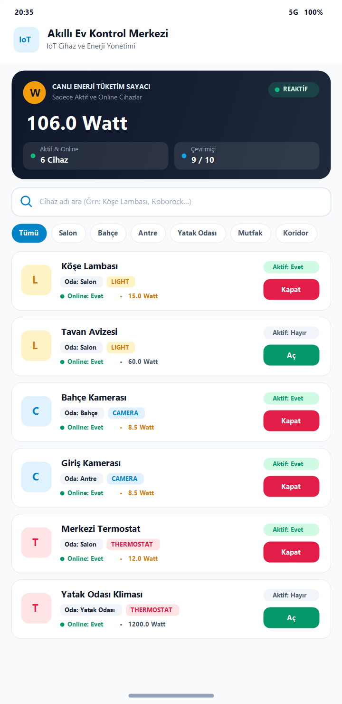
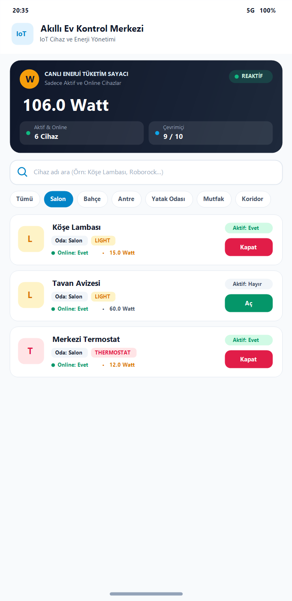
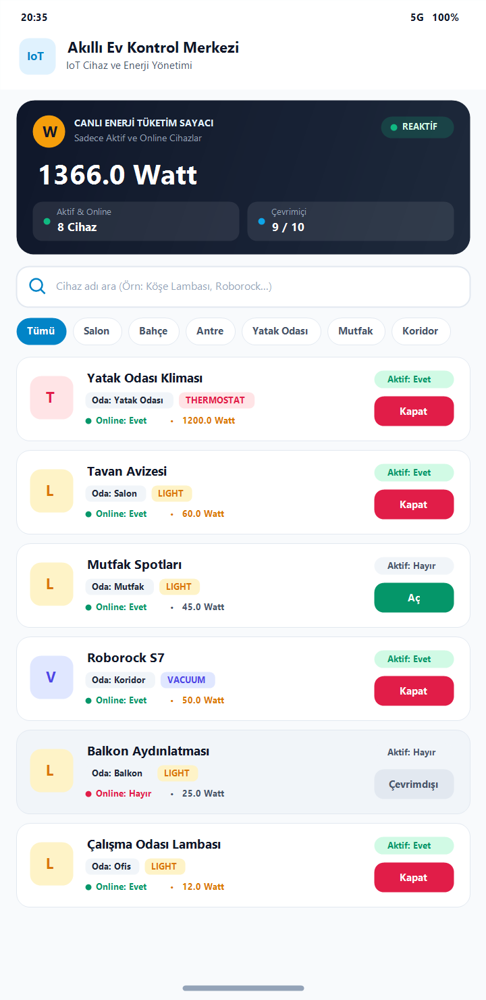
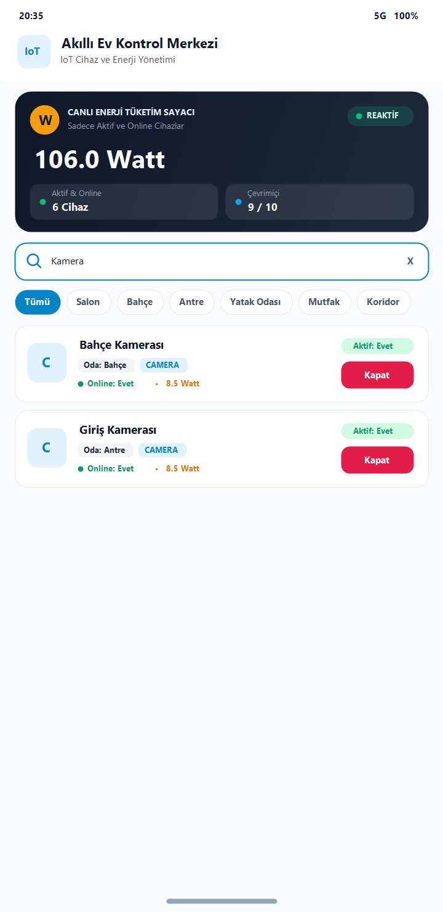

# week3_assignment - Akıllı Ev (IoT) Kontrol Merkezi

**GitHub Repository:** [https://github.com/alperkaansahbaz/week3_assignment](https://github.com/alperkaansahbaz/week3_assignment)

Evdeki akıllı cihazların durumunu, odalarını ve anlık enerji tüketimlerini reaktif bir şekilde yöneten **Jetpack Compose + Kurumsal MVVM + Coroutines + StateFlow** tabanlı Android uygulaması.

---

## Uygulama Ekran Görüntüleri

| 1. Başlangıç & Canlı Enerji Sayacı (`106.0 W`) | 2. Oda Filtrelemesi (`Salon` - 3 Cihaz) |
| :---: | :---: |
|  |  |

| 3. Reaktif Durum Değişimi (`1366.0 W`) | 4. Arama Çubuğu Filtrelemesi (`Kamera`) |
| :---: | :---: |
|  |  |

---

## Mimari ve Ödev İsterleri Uyumu

1. **Arama ve Oda Filtrelemesi (`SmartHomeViewModel`):**
   - Kullanıcı hem arama çubuğundan cihaz adına göre arama yapabilir hem de oda çipleri (`Tümü`, `Salon`, `Bahçe`, `Antre`, `Yatak Odası`, `Mutfak`, `Koridor`, `Balkon`, `Ofis`) üzerinden listeyi süzebilir.
2. **Reaktif Enerji Sayacı (`ReactiveEnergyCounterCard`):**
   - Ekranın en üstünde yer alan canlı sayaç kartı, yalnızca o an **Online (`isOnline = true`)** ve **Aktif (`isActive = true`)** olan cihazların anlık elektrik tüketimlerini otomatik olarak toplar ve gösterir (Başlangıç tüketimi: `106.0 Watt`).
3. **Reaktif Durum Değişimi (`toggleDeviceStatus`):**
   - Cihaz kartlarının yanındaki **Aç / Kapat** butonuna basıldığında ilgili cihazın aktiflik durumu anında değişir ve üstteki toplam enerji tüketim sayacı reaktif olarak güncellenir.
4. **Kural 1 - Katman Ayrımı (%100 Stateless Compose UI):**
   - `SmartHomeScreen.kt` (Compose UI katmanı) içinde **hiçbir filtreleme döngüsü (`.filter`) veya matematiksel hesaplama (`+`, `-`, `.sumOf`) yer almaz.** Arayüz tamamen durumsuz (stateless) olarak tasarlanmıştır; tüm hesaplamalar ve süzme işlemleri `SmartHomeViewModel` içinde yapılır.
5. **Kural 2 - Performans ve 120 FPS Akıcılık (Coroutines Thread Yönetimi):**
   - `SmartHomeViewModel` içerisinde `combine` ve `.flowOn(Dispatchers.Default)` kullanılarak tüm filtreleme ve enerji hesaplamaları arka plan thread havuzunda (CPU-bound) asenkron olarak yürütülür.
   - `SmartDeviceRepository` içerisinde başlangıç veri seti `withContext(Dispatchers.IO)` ile yüklenir.
   - `LazyColumn` ve `LazyRow` içerisinde benzersiz `key` tanımlamaları kullanılarak gereksiz recomposition'lar önlenmiştir.

## Proje Yapısı

```text
app/src/main/java/com/example/week3_assignment/
├── MainActivity.kt
├── data/
│   ├── model/
│   │   └── SmartDevice.kt
│   └── repository/
│       └── SmartDeviceRepository.kt
└── ui/
    ├── screens/
    │   └── SmartHomeScreen.kt
    ├── state/
    │   └── SmartHomeUiState.kt
    ├── theme/
    │   ├── Color.kt
    │   ├── Theme.kt
    │   └── Type.kt
    └── viewmodel/
        └── SmartHomeViewModel.kt
```
